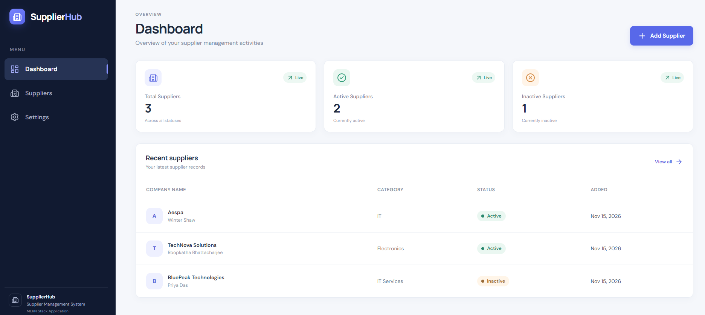
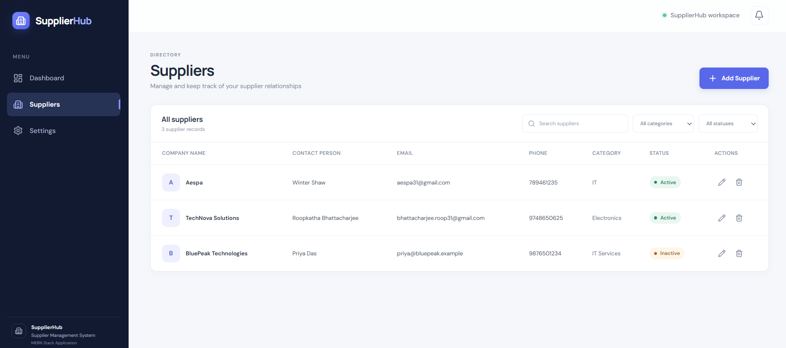
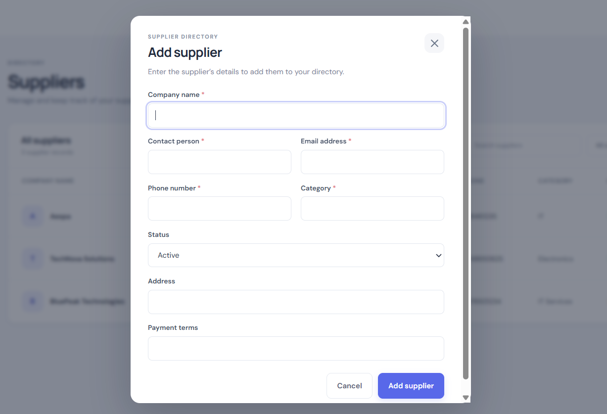
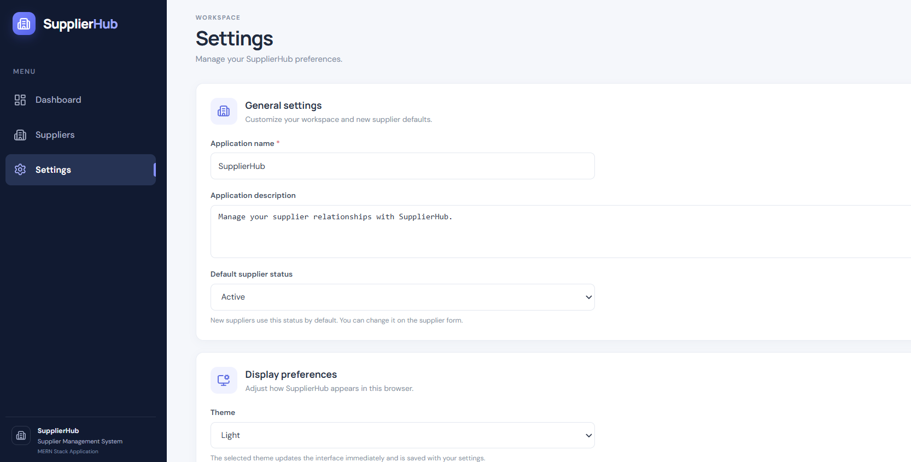

# SupplierHub

SupplierHub is a browser-based supplier management application built with the MERN stack. It provides a dashboard, supplier directory and CRUD workflows, local search and filters, a notification centre, and browser-persisted settings.

## Table of contents

- [Project overview](#project-overview)
- [Problem and objective](#problem-and-objective)
- [Features](#features)
- [Technology stack](#technology-stack)
- [Project structure](#project-structure)
- [Prerequisites](#prerequisites)
- [Environment configuration](#environment-configuration)
- [Installation and setup](#installation-and-setup)
- [Run both servers](#run-both-servers)
- [API overview](#api-overview)
- [Database](#database)
- [Screenshots](#screenshots)
- [Troubleshooting](#troubleshooting)
- [Current limitations and future improvements](#current-limitations-and-future-improvements)
- [Contribution and handover](#contribution-and-handover)
- [Detailed documentation](#detailed-documentation)

## Project overview

SupplierHub keeps supplier records in a MongoDB database and presents them through a React web interface. The frontend communicates with the Express API through Axios. Application settings and notification history are stored in the browser's `localStorage`; they are not stored in MongoDB or shared between browsers.

See [Project overview](./docs/PROJECT_OVERVIEW.md) and [System architecture](./docs/SYSTEM_ARCHITECTURE.md) for additional context.

## Problem and objective

Supplier information maintained across disconnected documents can be difficult to search, keep current, and summarize. SupplierHub provides a central supplier directory and a dashboard with supplier counts. Its objective is to let users manage supplier records and view their current status from one interface.

## Features

- **Dashboard:** total, active and inactive supplier statistics, plus the five most recent suppliers.
- **Supplier directory:** list and manage supplier records.
- **Add, edit and delete:** create supplier records, update their fields, and delete them after confirmation.
- **Search:** match suppliers by company name or contact person.
- **Filters:** narrow the directory by category and status.
- **Notification centre:** records successful add, edit and delete operations; supports unread counts, mark-as-read, mark-all-as-read and clear-all actions.
- **Settings and preferences:** editable application name and description, default status for new suppliers, and light/dark themes.

Notifications and settings are saved in browser `localStorage`. The notification centre retains up to 100 entries in the current browser.

## Technology stack

| Area | Technology |
|---|---|
| Frontend | React, Vite |
| Backend | Node.js, Express |
| Database access | Mongoose |
| Database | MongoDB |
| HTTP client | Axios |
| Icons | Lucide React |
| Server middleware | CORS, dotenv |

The client uses JavaScript and JSX. The API uses CommonJS JavaScript.

## Project structure

```text
supplier-management-system/
├── README.md
├── .gitignore
├── client/
│   ├── package.json
│   ├── package-lock.json
│   ├── index.html
│   ├── vite.config.js
│   └── src/
│       ├── App.jsx
│       ├── main.jsx
│       ├── components/
│       │   ├── AddSupplierModal.jsx
│       │   ├── NotificationCenter.jsx
│       │   ├── Sidebar.jsx
│       │   ├── StatCard.jsx
│       │   └── SupplierTable.jsx
│       ├── pages/
│       │   ├── Dashboard.jsx
│       │   ├── Settings.jsx
│       │   └── Suppliers.jsx
│       ├── services/api.js
│       └── styles/
│           ├── App.css
│           ├── Dashboard.css
│           ├── Notifications.css
│           └── Settings.css
├── server/
│   ├── package.json
│   ├── package-lock.json
│   ├── .env.example
│   ├── server.js
│   ├── config/db.js
│   ├── controllers/supplierController.js
│   ├── middleware/errorHandler.js
│   ├── models/Supplier.js
│   └── routes/
│       ├── dashboardRoutes.js
│       └── supplierRoutes.js
└── docs/
    ├── API_DOCUMENTATION.md
    ├── DATABASE_SCHEMA.md
    ├── PROJECT_OVERVIEW.md
    ├── SYSTEM_ARCHITECTURE.md
    └── USER_GUIDE.md
```

Local `.env` files are intentionally omitted from the tree and must not be committed. The companion Postman request files are currently in the workspace-level `..\postman\collections\Supplier Management API\` directory, outside this Git repository.

## Prerequisites

- Windows PowerShell for the commands below (other shells can use equivalent commands).
- Node.js and npm. The installed Vite 8 dependency declares support for Node.js `^20.19.0` or `>=22.12.0`; the installed Mongoose 9 dependency requires Node.js `>=20.19.0`. There is no project-level `engines` declaration.
- A MongoDB instance reachable by the backend.
- A modern browser with JavaScript and `localStorage` enabled.

## Environment configuration

### Backend

The server loads `server/.env` through `dotenv`. A checked-in `server/.env.example` lists the supported variable names. From the server directory, copy it and edit the local copy:

```powershell
Set-Location 'D:\MERN Projects\supplier-management-system\server'
Copy-Item .env.example .env
notepad .env
```

| Variable | Required | Behavior |
|---|---|---|
| `MONGODB_URI` | Yes | MongoDB connection URI passed to `mongoose.connect`. There is no fallback URI in the source. |
| `PORT` | No | API listening port. Defaults to `5000`. |
| `CLIENT_URL` | No | Allowed CORS origin. Defaults to `http://localhost:5173`. |

Provide your own valid MongoDB URI in the local `.env`. Never commit `.env` or paste credentials into documentation or issue reports. The root `.gitignore` excludes `.env` and `.env.*`, while allowing `.env.example`.

### Frontend

The Axios service reads `VITE_API_URL`. If it is unset, it uses `http://localhost:5000/api`. For a non-default API address, create `client/.env` and set `VITE_API_URL` to the API base URL, including `/api`. Vite environment variables are read when the development server starts; restart it after changing the file.

## Installation and setup

The frontend and backend have separate package manifests and lockfiles. Install dependencies in each directory:

```powershell
Set-Location 'D:\MERN Projects\supplier-management-system\server'
npm ci
```

Configure `server/.env` as described above, then install the client dependencies in another terminal:

```powershell
Set-Location 'D:\MERN Projects\supplier-management-system\client'
npm ci
```

Start or provision MongoDB separately. The backend exits during startup if it cannot connect to the configured MongoDB URI.

## Run both servers

Run the backend and frontend in **separate terminals**.

**Terminal 1 — backend:**

```powershell
Set-Location 'D:\MERN Projects\supplier-management-system\server'
npm run dev
```

`npm run dev` starts `nodemon server.js`. To run without nodemon, use `npm start`.

**Terminal 2 — frontend:**

```powershell
Set-Location 'D:\MERN Projects\supplier-management-system\client'
npm run dev
```

Open the Vite URL printed in the terminal (normally `http://localhost:5173`). Keep both processes running while using the application. By default, the backend allows that exact origin and the client calls `http://localhost:5000/api`.

The frontend package also defines:

```powershell
npm run build
npm run lint
npm run preview
```

There is no automated test script in either package manifest.

## API overview

The API is mounted under `/api`. The default base URL is `http://localhost:5000/api`.

| Method | Path | Purpose |
|---|---|---|
| `GET` | `/api/health` | Health response |
| `GET` | `/api/suppliers` | List suppliers; supports `search`, `category` and `status` query parameters |
| `GET` | `/api/suppliers/:id` | Retrieve one supplier |
| `POST` | `/api/suppliers` | Create a supplier |
| `PUT` | `/api/suppliers/:id` | Update allowed supplier fields |
| `DELETE` | `/api/suppliers/:id` | Delete a supplier |
| `GET` | `/api/dashboard/stats` | Count total, active and inactive suppliers |

The API does not implement pagination or authentication. See [API documentation](./docs/API_DOCUMENTATION.md) for request and response examples and error behavior.

## Database

The backend connects to the MongoDB URI in `MONGODB_URI` using Mongoose. The `Supplier` schema has required contact and company fields, optional address and payment terms, and a status enum. Mongoose timestamps add `createdAt` and `updatedAt`; the database name is selected by the configured URI, not hard-coded in application code. See [Database schema](./docs/DATABASE_SCHEMA.md).

## Screenshots









## Troubleshooting

| Symptom | Checks |
|---|---|
| Backend exits with a MongoDB connection error | Confirm `MONGODB_URI` is set in `server/.env`, the URI is valid, and the MongoDB instance is reachable. |
| Browser reports a CORS error | `CLIENT_URL` must exactly match the frontend origin, including host and port. The default is `http://localhost:5173`; `localhost` and `127.0.0.1` are different origins. |
| Dashboard or supplier requests fail | Confirm the backend is running and that the client API base (`VITE_API_URL`, if set) points to the backend `/api` base URL. |
| Port is already in use | Change `PORT` for the backend or use an available Vite port. If the frontend origin changes, update `CLIENT_URL` to match it. |
| Node reports an unsupported engine | Use a Node.js release supported by both installed dependencies: Vite 8 requires `^20.19.0` or `>=22.12.0`, and Mongoose 9 requires `>=20.19.0`. |
| `npm ci` fails | Check the Node/npm versions and rerun `npm ci` from the directory containing the relevant `package-lock.json`. |
| Settings or notifications do not appear on another device/browser | They are stored in the current browser's `localStorage`; they are not synchronized to the API or MongoDB. |

## Current limitations and future improvements

The current implementation does not include authentication or authorization, server-side pagination, automated test scripts, a seed-data workflow, or deployment/container configuration. Supplier search matches company name and contact person; category and status are exact-match filters. Notification history is browser-local and capped at 100 entries.

Potential future work includes:

- Add automated unit, API and browser tests.
- Introduce authentication and authorization if multiple users or teams are required.
- Add server-side pagination for larger supplier directories.
- Define a deployment and operational configuration, including secure secret management.
- Add documented data backup, migration and seed procedures if the project needs them.
- Synchronize preferences and notifications across browsers only if user accounts and server-side storage are introduced.

## Contribution and handover

No repository-level contribution guide or `LICENSE` file is present. The server package metadata contains an `ISC` license field, but that is not a substitute for confirming the intended project-wide license. Confirm contribution and redistribution expectations with the project owner before public release.

For a handover:

1. Provide the recipient with the repository and a separately provisioned MongoDB connection.
2. Share secret values through an approved secret-management channel, not through Git or this documentation.
3. Configure the backend and optional frontend environment variables on the recipient's machine.
4. Run both servers in separate terminals and verify the health endpoint and CRUD flows.
5. Review the current limitations above before planning production use.

The Postman requests in the workspace-level `..\postman\` directory can be used as an API reference; they are not part of this repository.

## Detailed documentation

- [Project overview](./docs/PROJECT_OVERVIEW.md)
- [System architecture](./docs/SYSTEM_ARCHITECTURE.md)
- [API documentation](./docs/API_DOCUMENTATION.md)
- [Database schema](./docs/DATABASE_SCHEMA.md)
- [User guide](./docs/USER_GUIDE.md)
