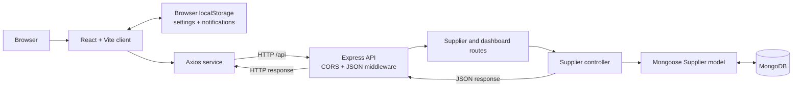

# SupplierHub System Architecture

## Components

### React frontend

The Vite client entry point is `client/src/main.jsx`, which renders `App`. `App` owns page selection, dashboard data, settings and notification state. The visible pages are `Dashboard`, `Suppliers` and `Settings`; navigation is implemented with component state rather than a URL router.

Reusable UI components include the supplier modal/table, dashboard statistic cards, sidebar and notification centre. Page and component styles are maintained in the client styles directory.

### Express backend

`server/server.js` configures dotenv, CORS and JSON request parsing. It registers:

- `GET /api/health`
- supplier routes under `/api/suppliers`
- dashboard routes under `/api/dashboard`
- a final error-handling middleware

The server waits for the MongoDB connection before starting to listen. The default port is `5000`.

### MongoDB and Mongoose

`server/config/db.js` connects Mongoose using `MONGODB_URI`. The `Supplier` model defines required company/contact fields, optional address and payment terms, status validation, and timestamps. The database name is determined by the URI, not by a hard-coded application setting.

### Axios communication

`client/src/services/api.js` exports one Axios instance. Its base URL is `VITE_API_URL`, or `http://localhost:5000/api` when that variable is unset. Page components use this instance for supplier and dashboard requests.

## Architecture diagram

## Request and response flow

1. A page or action handler calls the shared Axios instance.
2. Axios combines the requested path with its configured API base URL.
3. Express applies CORS and JSON parsing, then dispatches the request to a route.
4. The route invokes the relevant supplier controller.
5. The controller reads or mutates a Mongoose `Supplier` document, or computes counts from the model.
6. Express returns a JSON response. Errors that reach the final middleware are mapped to JSON error responses.
7. The client validates expected response shapes where implemented and updates its React state.

There is no authentication or authorization middleware in the current server.

## Supplier CRUD data flow

- **Create:** `AddSupplierModal` performs client-side required-field and email validation. `App` posts the form to `POST /api/suppliers`. After a successful response, the app records an “added” notification, refreshes dashboard/list data, and closes the modal.
- **Read/list:** `Suppliers` requests `GET /api/suppliers` with optional `search`, `category` and `status` parameters. The API returns matching records, sorted newest first. `GET /api/suppliers/:id` retrieves one record.
- **Update:** the supplier page submits the edited fields to `PUT /api/suppliers/:id`. Only the allowed supplier fields are copied by the controller. After a successful response, the client records an “updated” notification and refreshes the data.
- **Delete:** the page asks the user to confirm, then calls `DELETE /api/suppliers/:id`. It records a “deleted” notification only after the API request succeeds.

Failed mutations do not generate notifications because notification creation occurs after the awaited Axios mutation request resolves.

## Dashboard statistics flow

On initial load and refresh, `App` requests `/dashboard/stats` and `/suppliers` concurrently. The dashboard endpoint counts all suppliers, those with status `Active`, and those with status `Inactive`. The dashboard displays those values and the first five records from the supplier list.

## Local persistence

- **Settings:** `App` reads and writes the `supplierhub-settings` `localStorage` key. It contains application name, application description, default supplier status and theme. Defaults are `SupplierHub`, a short SupplierHub description, `Active` and `light`.
- **Notifications:** `App` reads and writes the `supplierhub-notifications` key. The value is a newest-first array of notification records (`id`, `type`, `message`, ISO timestamp and `read`). The list is capped at 100 entries. Mark-read, mark-all-read and clear-all actions update both React state and local storage.

Both features are browser-local. There is no server endpoint or database collection for either.

## Operational configuration

The server reads `MONGODB_URI`, optional `PORT` (default `5000`) and optional `CLIENT_URL` (default `http://localhost:5173`). The client can override its API base with `VITE_API_URL`. Local `.env` files are ignored by Git. No deployment or container configuration is present in the repository.
